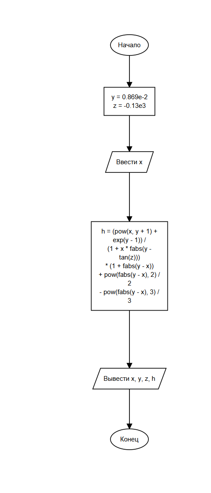

# Практическая работа 5. Использование функций стандартной библиотеки языка Си

## Состав работы

| Файл | Назначение |
| --- | --- |
| [lab5/lab5.c](lab5/lab5.c) | Задания 1–3 практической работы |
| [homeworklab5/homework.c](homeworklab5/homework.c) | Домашнее задание, вариант 15 |
| [lab5.slnx](lab5.slnx) | Решение Visual Studio с двумя отдельными проектами |

В каждой программе используется один `main`. Вычисления выполняются функциями стандартной библиотеки `math.h`.

## Задания практической работы

### Задание 1

Ввести целый угол в градусах, перевести его в радианы и вычислить синус с шестью знаками после точки:

```c
rad = gr * M_PI / 180;
sin(rad)
```

| Угол | Результат |
| --- | --- |
| 30 | 0.500000 |
| 60 | 0.866025 |
| 90 | 1.000000 |

### Задание 2

Сохранён вариант 2 из исходного проекта. Ввести `x`, задать `k = -4` и вычислить:

```c
a = log(fabs(-k * x));
b = exp(2 * x) + a * x;
y = x * pow(a, 3) + pow(b, 2);
```

При `x = 1.3`:

```text
a = 1.649
b = 15.607
y = 249.4
```

### Задание 3

Взять целые части `a`, `b`, `y`:

```c
A = (int)a;
B = (int)b;
C = (int)y;
```

Проверить условия:

- только одно из чисел A и B чётное;
- каждое из чисел A, B, C кратно трём.

Результат каждого условия выводится числом: `1` — выполнено, `0` — не выполнено. При `x = 1.3`: `A = 1`, `B = 15`, `C = 249`, оба условия дают `0`.

Для задания 2 требуется `x != 0`, поскольку логарифм нуля не определён. Для задания 3 вычисленные значения должны помещаться в `int`; для проверки подходят, например, `x = 0.5`, `1.3` и `-1`.

# Домашнее задание

## Вариант 15

### Условие задачи

Ввести `x` и вычислить выражение при постоянных `y = 0.869 * 10^-2` и `z = -0.13 * 10^3`:

```text
      x^(y+1) + e^(y-1)
h = --------------------- * (1 + |y - x|)
      1 + x * |y - tg(z)|

    |y - x|^2   |y - x|^3
  + --------- - ---------
        2           3
```

На языке C:

```c
h = (pow(x, y + 1) + exp(y - 1)) /
    (1 + x * fabs(y - tan(z))) * (1 + fabs(y - x))
    + pow(fabs(y - x), 2) / 2
    - pow(fabs(y - x), 3) / 3;
```

`tan` получает угол в радианах, поэтому `z = -130` используется непосредственно. Для вещественного результата степени в этом задании вводится `x >= 0`.

### Контрольный пример

Ввод: `2.444`.

```text
x = 2.444
y = 0.00869
z = -130
h = -0.49871
```

Результат совпадает с контрольным значением из задания.

### Блок-схема



[SVG](schemes/homework.svg) · [JSON для AwesomeSchemeGenerator](schemes/homework.json)

## Запуск в Visual Studio

1. Открыть `lab5.slnx` в установленной Visual Studio.
2. Выбрать нужный проект как запускаемый: `lab5` — задания 1–3, `homeworklab5` — домашнее задание.
3. Запустить через `Ctrl+F5`.

Дробные числа вводятся через точку. Для проверки основной программы можно ввести сначала `30`, затем `1.3`. Для домашнего задания — `2.444`.

## Материалы

[Работа № 5](https://olgmina.gitverse.site/course-c/praktika/rabota-5/index/)

# Информация о разработчике

**Трофимовский Артём**  
Группа: **бОТИ-261**
